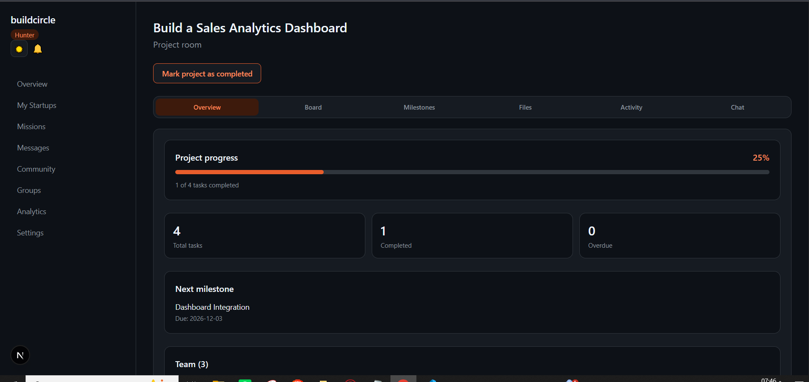
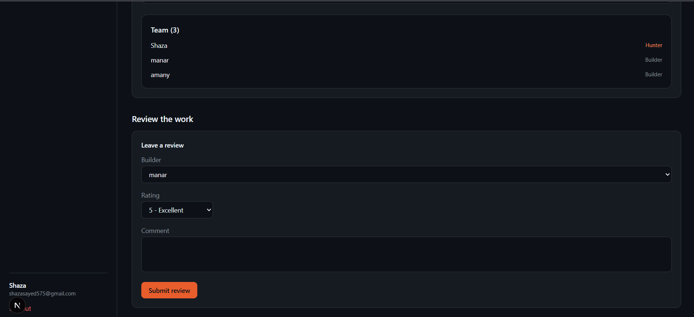
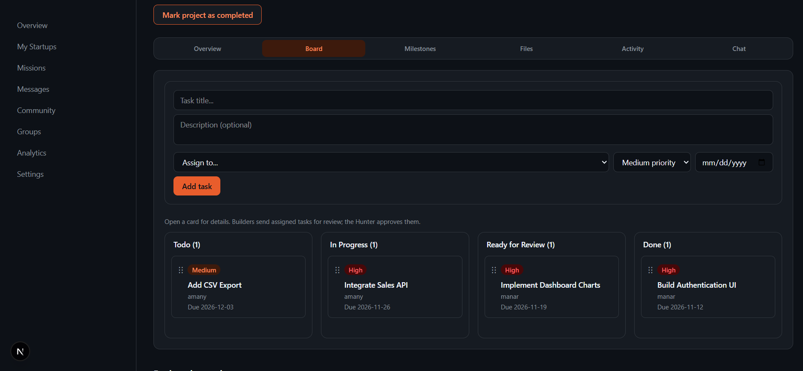
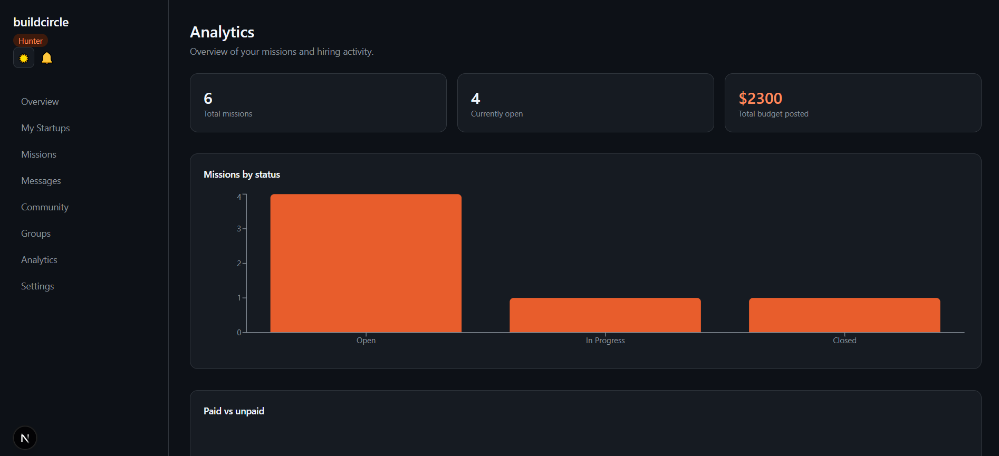

# Buildcircle

Buildcircle is a full-stack web application that connects startup founders with developers to build projects together.

Founders (Hunters) can create startups, post missions, review applications, and manage their teams. Developers (Builders) can explore missions, apply to opportunities, and collaborate with other builders in a shared project workspace.

**Live Website:** https://buildcircle-gold.vercel.app

## Tech Stack

- Next.js (App Router)
- React
- TypeScript
- Tailwind CSS
- Supabase (PostgreSQL, Authentication, Storage)
- dnd-kit

## Features

- Authentication with Hunter and Builder roles
- Startup profiles and mission listings
- Mission applications and team formation
- Project workspace with task management and milestones
- Drag-and-drop Kanban board with task review and approval
- Project chat with image sharing and replies
- Deliverable submissions, feedback, and revisions
- Direct messaging and notifications
- Community posts and groups
- Dashboard analytics
- Role-based access control using Supabase RLS

## Screenshots

### Project Overview

Track project progress, upcoming milestones, and team members.





### Kanban Board

Manage tasks across Todo, In Progress, Ready for Review, and Done.



### Dashboard Analytics

View mission statistics, hiring activity, and project-related insights.



## Try It Out

Visit the [live website](https://buildcircle-gold.vercel.app) and create an account as a Hunter or Builder.

The platform includes sample startup and mission data. Project rooms are private and accessible only to authorized team members.

## Local Development

Clone the repository and install dependencies:

```bash
git clone https://github.com/ShazaElsayedIsmail11/Buildcircle.git
cd Buildcircle
npm install
```

Create a `.env.local` file with your own Supabase configuration:

```env
NEXT_PUBLIC_SUPABASE_URL=
NEXT_PUBLIC_SUPABASE_ANON_KEY=
SUPABASE_SECRET_KEY=
```

Start the development server:

```bash
npm run dev
```

**Note:** Running a separate local instance requires a configured Supabase database with the project's tables, policies, and functions. Database migrations are not currently included in the repository.

Keep secret keys server-side and never commit `.env.local`.

## About

Buildcircle is a portfolio project developed to practice full-stack development, authentication, database design, authorization, and collaborative project workflows.
